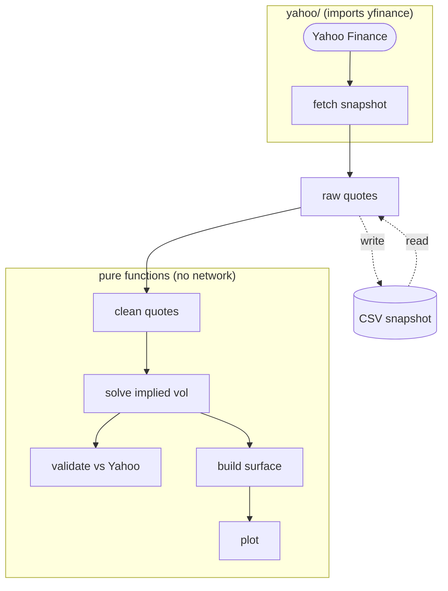

# Options Engine and Implied Volatility Surface

[](https://github.com/samvandiermen/Options-Engine-and-Implied-Volatility-Surface/actions/workflows/tests.yml)

This project uses the Black-Scholes formula to price options, calculate the Greeks,
and solve for implied volatility. Everything is written from scratch. It pulls live
SPX option data from Yahoo Finance (through the `yfinance` package) and uses it to
build an implied volatility surface.


*Built from a single snapshot of the SPX option chain. You can find an interactive
version in [figures/sample_surface.html](figures/sample_surface.html).*

## Architecture



Only one part of the code uses `yfinance`. It sits at the very start of the pipeline
and returns a plain DataFrame of raw quotes. Everything after that is ordinary code
without network access. That covers cleaning the quotes, solving for implied
volatility, building the surface and plotting. Splitting the code this way has three
advantages.

- The pricer and the solver were written and tested before any live data was
  pulled. None of the tests need internet.
- The raw DataFrame can be saved as a CSV snapshot. The rest of the pipeline works
  the same way with a live pull or a saved file. So you can run the whole project
  offline from the sample snapshot in the repo.
- The data could later come from somewhere else, such as a broker. Then only
  `fetch_snapshot()` in `optionsengine/yahoo/` has to change. The rest of the code
  only sees the DataFrame it returns, so nothing else needs to change.

## The parts

### Pricing and the Greeks

The pricer is plain Black-Scholes for a European call or put. The model assumes no
dividends, a constant risk-free rate and constant volatility. The section
"Limitations and assumptions" below explains what each of these costs.

$$
C = S\,N(d_1) - K e^{-rT} N(d_2) \qquad P = K e^{-rT} N(-d_2) - S\,N(-d_1)
$$

$$
d_1 = \frac{\ln(S/K) + (r + \sigma^2/2)\,T}{\sigma\sqrt{T}} \qquad d_2 = d_1 - \sigma\sqrt{T}
$$

The pricer handles two edge cases before it uses the formula. An option that has
already expired ($T = 0$) is worth its intrinsic value. If volatility is zero there
is no uncertainty left. The payoff is then known and only needs to be discounted. In
that case the call is worth $\max(S - Ke^{-rT},\,0)$. The strike is discounted
because it is only paid at expiry. This second case matters because the IV solver
uses it as its lower bound.

The five Greeks are delta, gamma, vega, theta and rho. They are the closed-form
derivatives of the price with respect to each input. Each Greek is tested against a
central finite difference of the pricer. A wrong sign or a missing term then shows
up as a failed test. Gamma and vega do not need an option type because they are the
same for a call and a put with the same strike and expiry.

The notebook [01_pricer_greeks.ipynb](notebooks/01_pricer_greeks.ipynb) walks
through this with plots.

### The implied volatility solver

Implied volatility is the volatility at which the Black-Scholes price equals the
market price. There is no formula for it. Black-Scholes turns a volatility into a
price and cannot be solved the other way round. So the solver has to search for the
volatility that fits.

It uses two methods. It first tries Newton-Raphson. This method uses the slope of
the price with respect to volatility, which is vega, to get close to the answer in a
few steps. Sometimes Newton goes wrong. It can step to a negative volatility or stop
making progress. The solver then switches to bisection. Bisection keeps halving an
interval that contains the answer. It is slower but it always works as long as the
answer lies in the starting range.

Three things make the solver more reliable than a simple loop.

- **The starting guess is a flat 20%.** The other option was the
  Brenner-Subrahmanyam formula. That formula works well when the strike is close to
  the spot price. It gets worse quickly further away, and most of the chain is far
  from the money. A fixed 20% is simpler. It also starts Newton where vega is large
  enough for a good first step, so the solver needs bisection less often.
- **The range is checked before solving.** The price rises with volatility. If the
  market price is below the price at 0.01% volatility or above the price at 500%, no
  volatility fits. The solver then returns a failed result with the reason instead
  of a wrong number.
- **Vega is checked at the answer.** Sometimes the price hardly changes with
  volatility near the solution. Many volatilities then fit the price almost equally
  well, so the answer means little. The solver marks such a result as failed.

Every result also stores which method found it. That shows how often the fallback
was needed. On the sample snapshot in the repo **98% is solved by Newton and 2% by
bisection**. The bisection cases are options with very little time left and strikes
far from the money. There vega is so small that Newton's step jumps outside the
search range.

The notebook [02_iv_solver.ipynb](notebooks/02_iv_solver.ipynb) shows the numbers
and the reasoning.

### Live data

The live data is SPX index options from Yahoo Finance, pulled with `yfinance`. You do
not need an account or a broker connection. SPX was chosen because its options are
European and settled in cash, which matches the Black-Scholes model. SPY options are
American and can be exercised early, so this model would price them wrongly.

The raw chain is large and much of it is not useful. So a few filters run before
anything is solved.

- **Which contracts.** SPX lists two roots for the same index. `SPXW` is weekly and
  settles at the 16:00 close. `SPX` is monthly and settles at the 09:30 open. When a
  date has both, `SPXW` is kept because it trades more. The longest expiries in the
  window have no `SPXW` contract yet, so `SPX` is used there.
- **Which strikes and expiries.** Only options with moneyness `K/F` between 0.80 and
  1.20 are kept, where `F` is the forward price. Time to expiry must be between one
  week and one year.
- **Which quotes.** The price used is the mid, `(bid + ask) / 2`. The last traded
  price is never used because it is often out of date outside market hours. Quotes
  are dropped if the bid or ask is missing, if the bid is above the ask, or if the
  spread is wider than half the mid. Only out-of-the-money options are kept. That
  means calls above the forward and puts below it. The market is tightest there, so
  the implied volatility is cleaner.
- **Time to expiry.** This is measured in hours from the exact time of the quote to
  the real settlement time of the contract. It is then converted to years on an
  ACT/365 basis. It does not use whole calendar days or the current clock time.

The notebook [03_live_surface.ipynb](notebooks/03_live_surface.ipynb) has more
detail.

### The surface

For a single expiry, implied volatility is not one number. It changes with the
strike. Options far from the money usually have a higher implied volatility than
options near the money. If you plot implied volatility against strike for one expiry
you get a curve called the volatility smile. The surface puts the smiles of all
expiries next to each other, from the nearest expiry to the furthest.

Two choices shape how it is built.

- **The x-axis is log-moneyness `ln(K/F)` and not the strike itself.** The forward
  `F` is different for each expiry. So a strike of 5000 sits in a different place on
  a one-week smile than on a one-year smile. With log-moneyness every smile has the
  at-the-money point at 0.
- **Each smile is built only from the quotes of its own expiry.** The interpolation
  uses a PCHIP spline. This spline keeps the shape of the data and does not add bumps
  that are not there. Outside the strikes that are actually quoted the surface is
  left empty instead of guessed.

The image at the top of this README is a static picture. The interactive version is
in [figures/sample_surface.html](figures/sample_surface.html). Download it and open
it in a browser to rotate it and see the values. GitHub only shows the HTML code and
not the page itself.

The notebook [03_live_surface.ipynb](notebooks/03_live_surface.ipynb) shows the full
build. It also looks at where the solved IV differs from the IV that Yahoo reports.

## Results

| Check | Result |
|---|---|
| Test suite | 716 tests pass, no network needed |
| Textbook cross-check | Matches Hull's worked example (call 4.76, put 0.81) |
| Put-call parity | Holds to within 1e-6 across the pricer and all five Greeks |
| Solver split | 98% Newton, 2% bisection on the committed sample snapshot |
| Solved IV vs Yahoo's IV | MAE 0.0155, RMSE 0.0185 (see the note in Limitations) |

Put-call parity is the main check that the pricer is correct. Parity follows from
a no-arbitrage argument and does not depend on Black-Scholes. That makes it a fair
test of the formula. The Greeks are checked in a similar way. Each one is compared
with a finite difference of the pricer. This catches sign and factor mistakes that
are easy to miss when you only derive the formulas by hand.

Most of the gap with Yahoo's IV comes from one assumption. Notebook 3 solves all
5,802 quotes in the sample snapshot again under four rate and dividend settings.
With no rate and no dividend the forward equals spot. In that case the MAE against
Yahoo drops from 0.0155 to 0.0019. So Yahoo appears to solve IV as if the forward
equals spot. This project still prices off the forward because that is more
correct. The gap is therefore not a mistake in the solver. Yahoo just makes a
different assumption about the forward.

## Limitations and assumptions

Black-Scholes is a simple model and this project uses a simple version of it on
purpose. Below is where it differs from reality and which way the error goes.

- **Constant volatility.** This is the main assumption of the model. The surface in
  this project shows clearly that it is false. If implied volatility were really
  constant the surface would be flat. Instead it changes with both strike and
  expiry.
- **Constant risk-free rate.** The rate is set once at 4% in the config file. It is
  not taken from live data.
- **No dividends.** SPX pays a dividend yield of around 1% a year and the model
  ignores it. The effect is small but always in the same direction. Model call prices
  come out a bit too low and put prices a bit too high. This is one reason SPX was
  chosen. It has the lowest dividend yield of the obvious index options, so leaving
  out dividends costs the least here.
- **European exercise.** The model assumes an option can only be exercised at
  expiry. This is true for SPX, which is why it was chosen over SPY.
- **Frictionless markets.** The model assumes there are no transaction costs and no
  arbitrage. It also assumes you can borrow and lend any amount at the same
  risk-free rate.
- **Mid price as fair value.** The width of the spread says something about
  liquidity and uncertainty. Using the mid ignores that.
- **Delayed quotes.** Yahoo's data lags behind the real market. It is not a
  real-time feed.
- **No arbitrage-free surface fit.** The surface is only interpolated. A trading
  desk would also make sure the surface has no calendar or butterfly arbitrage, for
  example with an SVI fit.
- **Yahoo's reported IV is not a clean benchmark.** Yahoo does not publish how it
  computes implied volatility. Notebook 3 suggests it treats the forward as equal to
  spot (see Results). Its IV may also come from a slightly different moment than the
  bid and ask shown next to it. So the MAE and RMSE above mix the error of the model
  with Yahoo's method and timing.

Logical next steps are American exercise with a binomial tree and other indices such
as NDX, RUT or XSP. The symbol is already kept separate in `config.py`, so adding an
index is mostly a change to the config.

## Getting started

```bash
git clone https://github.com/samvandiermen/Options-Engine-and-Implied-Volatility-Surface
cd Options-Engine-and-Implied-Volatility-Surface
pip install -r requirements.txt

python -m pytest tests/ -q            # 716 tests, no network needed

jupyter lab notebooks/                # walkthrough, runs from the committed sample

python scripts/fetch_snapshot.py      # pull a fresh SPX snapshot (needs internet and open markets)
python scripts/live_surface.py        # fetch, solve, plot, refresh on Enter
```

Built and tested with Python 3.14, numpy, scipy, pandas, plotly and yfinance.

## Project layout

| Path | What it does |
|---|---|
| `optionsengine/pricing.py` | Black-Scholes price, `d1`/`d2`, forward price |
| `optionsengine/greeks.py` | All five Greeks, closed form |
| `optionsengine/implied_vol.py` | Newton-Raphson with a bisection fallback |
| `optionsengine/config.py` | Symbol, rate, chain window, per-underlying settings |
| `optionsengine/yahoo/` | The only code that imports yfinance |
| `optionsengine/quotes.py` | Mid price, dropping bad quotes, OTM selection |
| `optionsengine/validation.py` | Solved IV vs Yahoo's, error by bucket and method |
| `optionsengine/surface.py` | Per-expiry smile interpolation into a surface grid |
| `optionsengine/plotting.py` | The 3D surface, individual smiles, term structure |
| `scripts/` | Command line scripts to fetch a snapshot or run the live view |
| `notebooks/` | Pricer and Greeks, solver behaviour, the live surface |
| `tests/` | 716 tests, synthetic data only, no network |

---

## AI usage statement

Claude (Anthropic) was used during this project, mainly through Claude Code. It
helped write and debug the code and the tests, and it helped with the wording of the
README and the notebooks. The project design, the choice of methods and the
interpretation of the results are my own.

## Licence

MIT, see [LICENSE](LICENSE).
